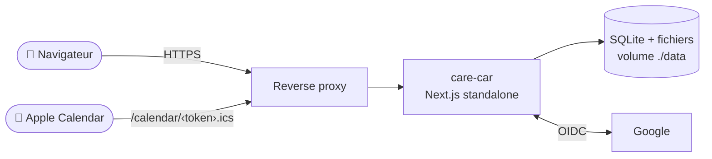

<div align="center">

# 🚗 care-car

**Le carnet d'entretien de vos véhicules, dans votre poche.**

Échéances, interventions, factures, coûts : tout ce qu'un tableur ne fait pas (bien).
Auto-hébergé, mobile d'abord, vos données restent chez vous.

[](https://github.com/gaetanars/care-car/actions/workflows/ci.yml)


[Fonctionnalités](#-fonctionnalités) · [Installation](#-installation) · [Configuration Google](#-configuration-de-la-connexion-google) · [Variables](#-variables-denvironnement) · [Développement](#-développement)

</div>

---

> [!NOTE]
> **Statut : V1 en cours de réalisation.** Le moteur de règles, le schéma de données et l'authentification sont en place ; les écrans véhicules, interventions, tableau de bord, iCal, export PDF et analytique suivent. Voir [`docs/ROADMAP.md`](docs/ROADMAP.md).

## ✨ Fonctionnalités

|                                  |                                                                                                                                  |
| -------------------------------- | -------------------------------------------------------------------------------------------------------------------------------- |
| 🔧 **Plan d'entretien**          | Opérations périodiques par véhicule (km et/ou mois), copiées depuis un plan type par énergie puis modifiables.                   |
| 📅 **Échéances et statuts**      | Calcul automatique, avec **projection kilométrique** quand la date n'est pas fixée. Contrôle technique inclus (48 mois puis 24). |
| 🧾 **Journal des interventions** | Opérations, pièces, main d'œuvre, prestataire (garage ou « Moi-même »), factures jointes converties en PDF.                      |
| 🛣️ **Relevés kilométriques**     | Gestion du changement de compteur : le km _affiché_ est saisi, les calculs utilisent le km _réel_.                               |
| 🔔 **Flux iCal**                 | Une URL privée par utilisateur à abonner dans Apple Calendar, avec alarme J-28.                                                  |
| 📄 **Export PDF du carnet**      | Fiche véhicule, historique, totaux et factures agrégées en un seul PDF, prêt pour la revente.                                    |
| 📊 **Analytique**                | Fréquence et coûts par véhicule, période et catégorie (pièces seules ; main d'œuvre en ligne séparée).                           |
| 🔒 **Multi-utilisateur, isolé**  | Connexion Google, liste blanche d'emails, deux rôles. Un utilisateur ne voit jamais les véhicules d'un autre, admin compris.     |

Montants en centimes TTC, dates ISO, interface en français. Pas de worker ni de tâche planifiée : tout est calculé à la demande.

## 🏗️ Architecture



- **Une seule application** Next.js (App Router) + TypeScript strict, Tailwind + shadcn/ui.
- **SQLite** (WAL) via Drizzle ; migrations appliquées au démarrage.
- **PDF générés dans l'application** (pdf-lib pour la fusion), sans service annexe.
- **Instance unique avec disque persistant** : le serverless est exclu (SQLite).

## 🚀 Installation

Prérequis communs : un nom de domaine en **HTTPS** (requis par Google OAuth et les cookies `Secure`) et un [client OAuth Google](#-configuration-de-la-connexion-google).

### 1. Docker Compose (recommandé)

```bash
git clone https://github.com/gaetanars/care-car.git
cd care-car

cp .env.example .env
# Renseigner .env (voir le tableau des variables) ; générer le secret :
openssl rand -base64 32      # → AUTH_SECRET

docker compose up -d --build
```

L'application écoute sur le port `3000`. `DATA_DIR` est déjà fixé par le `docker-compose.yml`. Les données vivent dans `./data` (base SQLite, fichiers, sauvegardes).

Vérification : `curl http://localhost:3000/api/health`.

#### Image publiée

La CI publie l'image sur `ghcr.io/gaetanars/care-car` : `main` (dernier commit de `main`), `X.Y.Z`, `X.Y` et `latest` (releases `vX.Y.Z`; une pré-version ne produit que son tag exact). Le package étant privé, un login est requis (PAT classique, scope `read:packages`) :

```bash
echo $PAT | docker login ghcr.io -u <user> --password-stdin
docker pull ghcr.io/gaetanars/care-car:latest
```

### 2. NAS Synology (DSM)

Cible initiale du projet (DS918+, `linux/amd64`).

1. **Container Manager** → Projet → créer depuis le dossier cloné (`docker-compose.yml` + `.env`).
2. **Panneau de configuration → Portail de connexion → Proxy inversé** : `https://carnet.<votre-domaine>.synology.me` → `http://localhost:3000`, certificat Let's Encrypt.
3. `APP_URL` = cette URL HTTPS publique.
4. **Sauvegarde** : une copie du fichier SQLite en cours d'écriture n'est pas fiable. Planifier dans _Planificateur de tâches_ un instantané cohérent, puis protéger `data/backups/` et `data/files/` avec Hyper Backup :

   ```bash
   docker exec <conteneur-app> node -e "
     const db = require('better-sqlite3')('/data/care-car.db');
     db.exec(\"VACUUM INTO '/data/backups/care-car-' || strftime('%Y%m%d') || '.db'\");
   "
   ```

   > [!WARNING]
   > Le nom du fichier de base (`care-car.db` ci-dessus) est à vérifier dans `DATA_DIR` avant de planifier la tâche.

### 3. Cloud (VM ou conteneur avec volume)

Même image, **une seule instance** avec un **disque persistant** monté sur `DATA_DIR` (ex. VM + Docker, Fly.io avec volume, service de conteneurs avec stockage attaché). Placer un reverse proxy HTTPS devant (Caddy, Traefik, load balancer du fournisseur). Pas de Cloud Run, Lambda ou Vercel : la base est un fichier local.

```bash
docker run -d --name care-car -p 3000:3000 \
  --env-file .env -e DATA_DIR=/data \
  -v /srv/care-car:/data ghcr.io/gaetanars/care-car:latest
```

Build local en alternative : `docker buildx build --platform linux/amd64 -t care-car .`, puis remplacer l'image par `care-car`.

### 4. Sans Docker (Node)

Node ≥ 26 et pnpm requis.

```bash
pnpm install --frozen-lockfile
cp .env.example .env         # puis renseigner (DATA_DIR = ./data par exemple)
pnpm build
pnpm start                   # http://localhost:3000
```

## 🔐 Configuration de la connexion Google

care-car n'a **pas de mot de passe** : l'authentification passe uniquement par Google (OIDC, scopes `openid email profile`). Un compte Google dont l'email n'est pas dans la liste blanche est refusé.

### Étapes dans la Google Cloud Console

1. Ouvrir <https://console.cloud.google.com/> et **créer un projet** (ex. `care-car`).
2. **API et services → Écran de consentement OAuth** (ou _Google Auth Platform → Branding_) :
   - Type d'utilisateur : **Externe** (ou _Interne_ si vous avez un Google Workspace et que tous les utilisateurs en font partie).
   - Renseigner le nom de l'application et l'email d'assistance.
   - Scopes : `openid`, `email`, `profile` (scopes par défaut, aucun scope sensible).
   - En mode **Test**, ajouter chaque utilisateur dans _Utilisateurs de test_. Pour un petit cercle privé, ce mode suffit ; sinon, **Publier l'application** (aucune validation Google requise avec ces seuls scopes).
3. **API et services → Identifiants → Créer des identifiants → ID client OAuth** :
   - Type d'application : **Application Web**.
   - **Origines JavaScript autorisées** : `APP_URL` (ex. `https://carnet.example.synology.me`).
   - **URI de redirection autorisés** :

     ```
     <APP_URL>/api/auth/callback/google
     ```

     Exemple : `https://carnet.example.synology.me/api/auth/callback/google`
4. Copier l'**ID client** et le **Code secret** dans `.env` :

   ```dotenv
   GOOGLE_CLIENT_ID=123456789-abc.apps.googleusercontent.com
   GOOGLE_CLIENT_SECRET=GOCSPX-...
   ```

5. Définir `ADMIN_EMAIL` avec l'adresse Google du premier administrateur, puis (re)démarrer l'application.

### Fonctionnement côté application

- **`ADMIN_EMAIL`** est inscrit d'office dans la liste blanche, avec le rôle admin, à chaque démarrage.
- **Il n'y a pas d'inscription libre.** L'admin pré-enregistre les emails autorisés ; au premier login Google, la ligne est liée au compte. Un email inconnu reçoit `signup_disabled`.
- **Retirer un utilisateur** de la liste blanche bloque sa connexion et **supprime ses sessions** immédiatement. Ses données sont conservées.
- Sessions : cookie HttpOnly, Secure, SameSite=Lax, 30 jours glissants.

### Dépannage

| Symptôme                                       | Cause probable                                                                                                   |
| ---------------------------------------------- | ---------------------------------------------------------------------------------------------------------------- |
| `redirect_uri_mismatch`                        | L'URI déclarée dans Google diffère de `<APP_URL>/api/auth/callback/google` (schéma, domaine, slash final, port). |
| `access_blocked` / « application non validée » | Mode Test : l'utilisateur n'est pas dans _Utilisateurs de test_.                                                 |
| Retour sur `/login` avec une erreur            | Email absent de la liste blanche, ou retiré.                                                                     |
| Boucle de connexion derrière un proxy          | `APP_URL` en `http://` alors que le proxy sert en HTTPS, ou en-têtes `X-Forwarded-*` non transmis.               |

## ⚙️ Variables d'environnement

| Variable               | Obligatoire | Rôle                                                                   |
| ---------------------- | :---------: | ---------------------------------------------------------------------- |
| `APP_URL`              |     ✅      | URL publique HTTPS, sans slash final (sert de base au callback OAuth). |
| `GOOGLE_CLIENT_ID`     |     ✅      | ID du client OAuth Google.                                             |
| `GOOGLE_CLIENT_SECRET` |     ✅      | Secret du client OAuth Google.                                         |
| `AUTH_SECRET`          |     ✅      | Secret de signature des sessions (`openssl rand -base64 32`).          |
| `ADMIN_EMAIL`          |     ✅      | Email Google de l'administrateur initial.                              |
| `DATA_DIR`             |     ✅      | Répertoire de la base SQLite et des fichiers (`/data` en conteneur).   |

> [!IMPORTANT]
> Les secrets restent dans `.env` ou les variables d'environnement. Ne jamais les committer.

## 🛠️ Développement

```bash
pnpm install
cp .env.example .env
pnpm dev                 # http://localhost:3000

pnpm check               # typecheck + lint + tests (100 % de branches sur src/domain)
pnpm test:e2e            # Playwright, viewport mobile, build de production
pnpm db:generate         # nouvelle migration depuis src/server/db/schema.ts
pnpm format              # Prettier
```

```
src/domain/        moteur de règles pur (ni base, ni HTTP)
src/server/db/     client Drizzle, schéma
src/server/data/   seule couche d'accès base, filtrée par propriétaire
src/server/auth/   Better Auth
src/app/           écrans et routes
drizzle/           migrations générées
seed/              catalogue et plans types
```

Documentation de référence : [`SPEC.md`](SPEC.md) (spécifications V1) · [`docs/ROADMAP.md`](docs/ROADMAP.md) (jalons).

---

<div align="center"><sub>Fait pour remplacer un tableur Numbers, et ne plus jamais rater une vidange.</sub></div>
